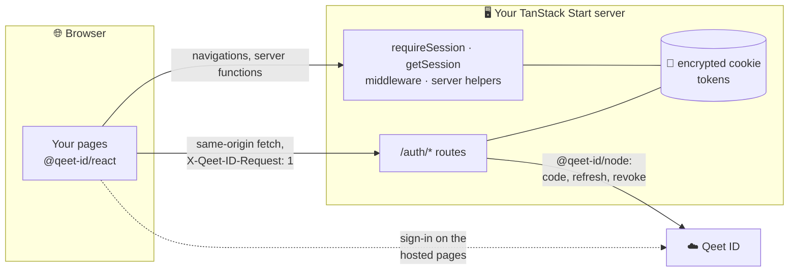
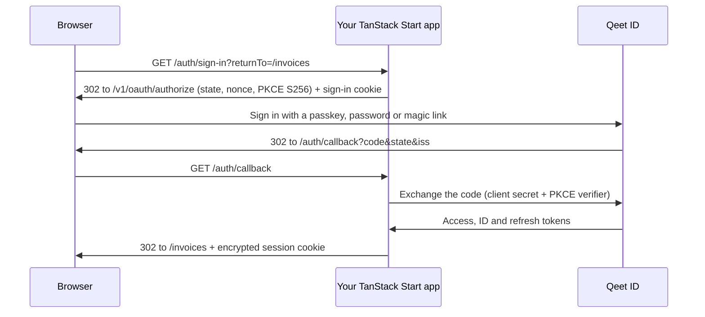

<div align="center">

# 🔐 Qeet ID for TanStack Start

**Sign-in, sessions and route protection for TanStack Start apps: people sign in on Qeet ID's hosted pages, and the tokens stay on your server.**

[](#-install)
[](#-install)
[](#-install)
[](#-typescript-and-modules)
[](#-how-sign-in-works)
[](test)

[🌐 Qeet ID](https://id.qeet.in) · [📖 Docs](https://docs.qeet.in) · [🚀 Quick start](#-quick-start) · [⚛️ React SDK](https://github.com/qeetgroup/qeet-id-react) · [🟢 Node SDK](https://github.com/qeetgroup/qeet-id-node) · [📝 Changelog](CHANGELOG.md)

</div>

## 🧭 What it's for

`@qeet-id/tanstack` adds **Sign in with Qeet ID** to a TanStack Start app. Visitors sign in on Qeet ID's hosted pages
with a passkey, a password or a magic link, and come back signed in. Your loaders, server functions, server routes and
components know who they are. The access, ID and refresh tokens live in an encrypted, HttpOnly cookie on your server's
side of the wire: the browser never holds a token and never calls Qeet ID.

## 📦 What's inside

| | |
|:--|:--|
| 🚪 **Session routes** | Sign-in, sign-up, callback, session, sign-out and organisation switching, from one catch-all server route |
| 🍪 **Encrypted sessions** | An AES-256-GCM sealed, `HttpOnly`, `SameSite=Lax`, `__Host-` cookie; secrets rotate without signing anyone out |
| 🔄 **Renewal** | The access token is renewed in its last minute, once per refresh token even under parallel requests |
| 🛡️ **Protection** | A `beforeLoad` guard for pages, and request middleware for server functions and server routes |
| 👤 **The session anywhere** | `getSession()` in loaders and `beforeLoad`, on the server while rendering and over RPC on navigation |
| ⚛️ **Components** | Everything from `@qeet-id/react`, with its provider wired to the session the server rendered: no flash |
| 🏢 **Organisations and access** | The organisation's name, roles and permissions with an API key, and `checkPermission` for the real check |
| 🚨 **Typed errors** | `ConfigurationError`, `NotSignedInError` and `SessionUnavailableError`, extending `@qeet-id/node`'s `QeetIDError` |

## 🔗 How it fits

| Package | Runs in | Role |
|:--|:--|:--|
| [`@qeet-id/react`](https://github.com/qeetgroup/qeet-id-react) | Browser | `useSession`, `useUser`, `SignedIn`, `SignedOut`, `Protect`, `UserButton` and the sign-in buttons, talking only to your `/auth/*` routes |
| **`@qeet-id/tanstack`** | Your TanStack Start server and browser | This package: the `/auth/*` routes, the cookie session, the guard, the middleware and the server helpers |
| [`@qeet-id/node`](https://github.com/qeetgroup/qeet-id-node) | Server | The code exchange, ID token verification, renewal, revocation and the management API |



## 🔑 How sign-in works



At the callback the app checks the `state` against the sign-in cookie, the `iss` against the issuer (RFC 9207) and the ID
token's ES256 signature, issuer, audience, expiry and `nonce`, then seals the tokens into the session cookie.

## 📥 Install

Node.js 22.12 or later, TanStack Start 1.169 or later, React 19.

```sh
bun add @qeet-id/tanstack @qeet-id/react @qeet-id/node
# or: npm install · pnpm add · yarn add, with the same three packages
```

In Qeet ID, create a **confidential web application** in your organisation, and register:

| | |
|:--|:--|
| ↩️ **Redirect URI** | `https://app.example.com/auth/callback` (and `http://localhost:3000/auth/callback` for development) |
| 👋 **Post-logout redirect URI** | `https://app.example.com/`, and any page you pass as `returnTo` when signing out |
| 🔁 **Grant types** | `authorization_code`, and `refresh_token` so sessions last longer than one access token |

## ⚙️ Environment variables

| Variable | Required | |
|:--|:--|:--|
| `QEET_ID_CLIENT_ID` | ✅ | The application's client id |
| `QEET_ID_CLIENT_SECRET` | ✅ | The application's client secret |
| `QEET_ID_REDIRECT_URI` | ✅ | `{your origin}{base path}/callback`, exactly as registered. Its origin is the app's origin: return paths and `Origin` headers are checked against it |
| `QEET_ID_COOKIE_SECRET` | ✅ | At least 32 random characters (`openssl rand -base64 32`). To rotate, list the new secret first, comma-separated: `new,old` |
| `QEET_ID_BASE_URL` | | Qeet ID's API. Default `https://api.id.qeet.in` |
| `QEET_ID_BASE_PATH` | | Where the session routes live. Default `/auth` |
| `QEET_ID_SCOPES` | | Default `openid email profile`. Add `offline_access` if the application lists it among its scopes |
| `QEET_ID_POST_SIGN_OUT_REDIRECT_URI` | | Where Qeet ID sends people after signing out. Default `{your origin}/` |
| `QEET_ID_SESSION_MAX_AGE` | | Seconds a session lasts without renewal. Default `2592000` (30 days, Qeet ID's refresh token lifetime) |
| `QEET_ID_API_KEY` | | A server-side API key: fills the session's organisation name, roles and permissions, and enables `checkPermission` |

Plain `http` is accepted for `localhost` only; there the cookies drop `Secure` and the `__Host-` prefix. A missing or
wrong variable throws a `ConfigurationError` naming every problem, never a value. To fail at startup rather than on the
first request, call `loadConfig()` from `@qeet-id/tanstack/server` when the server starts.

## 🚀 Quick start

**1. The session routes.** One catch-all server route at the base path serves all six:

```ts
// src/routes/auth/$.ts
import { createFileRoute } from "@tanstack/react-router";
import { authRouteHandlers } from "@qeet-id/tanstack/server";

export const Route = createFileRoute("/auth/$")({
  server: { handlers: authRouteHandlers },
});
```

**2. The provider.** Read the session in the root route's `beforeLoad`; the provider picks it up from the router
context, so the server-rendered page already shows who is signed in:

```tsx
// src/routes/__root.tsx
import { HeadContent, Outlet, Scripts, createRootRoute } from "@tanstack/react-router";
import { QeetIDProvider, getSession } from "@qeet-id/tanstack";

export const Route = createRootRoute({
  beforeLoad: async () => ({ session: await getSession() }),
  shellComponent: ({ children }) => (
    <html lang="en">
      <head>
        <HeadContent />
      </head>
      <body>
        {children}
        <Scripts />
      </body>
    </html>
  ),
  component: () => (
    <QeetIDProvider>
      <Outlet />
    </QeetIDProvider>
  ),
});
```

**3. CSRF protection for server functions.** Once `src/start.ts` exists, TanStack Start no longer adds its own:

```ts
// src/start.ts
import { createCsrfMiddleware, createStart } from "@tanstack/react-start";

const csrfMiddleware = createCsrfMiddleware({ filter: (ctx) => ctx.handlerType === "serverFn" });

export const startInstance = createStart(() => ({ requestMiddleware: [csrfMiddleware] }));
```

**4. Use it.**

```tsx
import { SignInButton, SignedIn, SignedOut, UserButton, useUser } from "@qeet-id/tanstack";

export function Header() {
  const { user } = useUser();
  return (
    <header>
      <SignedOut>
        <SignInButton />
      </SignedOut>
      <SignedIn>
        <span>Hello, {user?.name ?? user?.email}</span>
        <UserButton />
      </SignedIn>
    </header>
  );
}
```

## 🚪 The session routes

| Route | Method | Answers |
|:--|:--|:--|
| `/auth/sign-in?returnTo=` | GET | `302` to Qeet ID's authorization endpoint |
| `/auth/sign-up?returnTo=` | GET | The same: Qeet ID's hosted sign-in page offers sign-up |
| `/auth/callback` | GET | `302` to the saved return path, or to it with `?authError=<code>` when signing in failed |
| `/auth/session` | GET | `200 { "session": Session \| null }`; renews the access token near expiry |
| `/auth/sign-out` | POST | `200 { "redirectTo": string }`: Qeet ID's sign-out page, which ends the hosted-login session too |
| `/auth/switch-organization` | POST | `200 { "session" }` for the current organisation; `501` for another (see [Organisations](#-organisations)) |

They implement the session contract `@qeet-id/react` speaks (its `docs/session-contract.md`). Every answer is
`Cache-Control: no-store`, errors are `{ "error": { "code", "message" } }`, and no answer carries a CORS header.

## 🛡️ Protecting routes

**Pages:** `requireSession()` as a `beforeLoad` lets signed-in people through, adds `session` to the route's context, and
sends anyone else to sign in and back to the page they asked for.

```tsx
// src/routes/_signed-in.tsx
import { createFileRoute } from "@tanstack/react-router";
import { requireSession } from "@qeet-id/tanstack";

export const Route = createFileRoute("/_signed-in")({
  beforeLoad: requireSession(),
});

// src/routes/_signed-in/invoices.tsx
export const Route = createFileRoute("/_signed-in/invoices")({
  component: () => {
    const { session } = Route.useRouteContext();
    return <h1>Invoices for {session.organization?.name}</h1>;
  },
});
```

When a sign-in fails, the callback returns to the page with `?authError=`; on that page the guard throws a
`QeetIDError` with the code (`access_denied`, …) instead of sending the browser round again. Show it with the route's
`errorComponent`.

**Data:** a guard protects the page, not the data. Protect every server function and server route that reads or changes
private data with `requireSessionMiddleware`:

```ts
import { createServerFn } from "@tanstack/react-start";
import { requireSessionMiddleware } from "@qeet-id/tanstack";

export const listInvoices = createServerFn()
  .middleware([requireSessionMiddleware])
  .handler(async ({ context }) => invoicesOf(context.session.organization!.id));
```

A signed-out call to a server function fails with `NotSignedInError`; a server route answers `401`
`{ "error": { "code": "not_signed_in" } }`. `sessionMiddleware` adds `context.session` without refusing anyone, and also
fits `requestMiddleware` in `src/start.ts` to read the session for every request.

## 👤 The session in loaders and server code

```ts
import { getSession } from "@qeet-id/tanstack";

export const Route = createFileRoute("/settings")({
  loader: async () => {
    const session = await getSession();
    return { email: session?.user.email ?? null };
  },
});
```

`getSession()` is a server function: in a loader or `beforeLoad` it runs on the server while rendering, and through an
RPC on a client-side navigation. It answers the contract's `Session`, which carries no token:

```json
{
  "user": { "id": "0b9a2c7e-…", "email": "meera@brightleaffoods.in", "emailVerified": true, "name": "Meera Iyer", "picture": "https://…" },
  "organization": { "id": "5f0c1d2e-…", "name": "Brightleaf Foods" },
  "roles": ["Finance approver"],
  "permissions": ["invoice.approve", "invoice.read"],
  "expiresAt": "2026-12-05T09:30:00.000Z"
}
```

Server-only helpers, from `@qeet-id/tanstack/server`:

| Helper | |
|:--|:--|
| `getAccessToken()` | The session's access token, renewed when close to expiry, to call an API that accepts Qeet ID tokens. Keep it on the server |
| `checkPermission(permission)` | Asks Qeet ID now whether the signed-in person holds a permission (roles and attribute policies together). Needs `QEET_ID_API_KEY` |
| `getQeetIDClient()` | The configured `@qeet-id/node` client, for the management API |
| `authRouteHandlers` | The session routes' handlers |
| `loadConfig()` | Reads and checks the environment; throws `ConfigurationError` |

Called in the browser, the server-only helpers throw instead of running.

## 🏢 Organisations

A Qeet ID application belongs to one organisation, and its sign-in is always for that organisation: the session's
`organization.id` is the ID token's `tenant_id`. With `QEET_ID_API_KEY`, the session also carries the organisation's name
and the person's role names and permission keys, looked up at sign-in and every five minutes after.

**`roles` and `permissions` are hints for the UI.** Decide what someone may do on the server, with `checkPermission`:

```ts
import { checkPermission } from "@qeet-id/tanstack/server";

export const approveInvoice = createServerFn({ method: "POST" })
  .middleware([requireSessionMiddleware])
  .validator((data: { invoiceId: string }) => data)
  .handler(async ({ data }) => {
    if (!(await checkPermission("invoice.approve"))) throw new Error("Not allowed");
    return approve(data.invoiceId);
  });
```

Qeet ID doesn't let an application move a person's sign-in to another organisation, so
`POST /auth/switch-organization` answers `501 organization_switch_unavailable` for any organisation but the current one.

## 👋 Signing out

`<SignOutButton>` and `useQeetID().signOut()` from `@qeet-id/react` call `POST /auth/sign-out`. The server revokes the
refresh token at Qeet ID, clears the session cookie and answers Qeet ID's sign-out URL, with the ID token as the hint, so
the hosted-login session ends too. Qeet ID then sends the browser to `returnTo` on your site when one was given and is
registered as a post-logout redirect URI, otherwise to `QEET_ID_POST_SIGN_OUT_REDIRECT_URI`.

Signing out of Qeet ID ends the refresh grants every application received in that sign-in, so the other apps' sessions
end at their next renewal, within ten minutes.

## 🔒 Security

| | |
|:--|:--|
| 🍪 **Cookies** | `HttpOnly`, `Secure`, `SameSite=Lax`, `Path=/`, no `Domain`, the `__Host-` prefix; sealed as a JWE (`dir`, `A256GCM`) with a key derived per secret and purpose by HKDF |
| 🧾 **Tokens** | Never in the browser, never in the session JSON, never in a log. A typical session seals to about 2.4 KB, one cookie; a long permission list is split into chunks |
| 🧱 **CSRF** | POSTs need `X-Qeet-ID-Request: 1`, and are refused with `Sec-Fetch-Site: cross-site` or another `Origin`. No state changes on GET |
| ↩️ **Redirects** | Every `returnTo` must be a path on your site; `//host`, `/\host`, other origins and schemes become `/` |
| 🔁 **Renewal** | Requests carrying the same refresh token share one renewal for a minute: Qeet ID ends the whole grant when a spent refresh token comes back |
| 🗄️ **Caching** | Session routes, and pages rendered with the session, are `Cache-Control: no-store` |

Sessions live in the cookie, so instances need only the same `QEET_ID_COOKIE_SECRET`. Renewals are shared within one
process; across instances, a burst of parallel requests at the moment of renewal can still race, and Qeet ID then ends
the session. Route a person's requests to one instance (sticky sessions) where that matters.

## 🚨 Errors

| Error | Code | When |
|:--|:--|:--|
| `ConfigurationError` | `invalid_configuration` | A `QEET_ID_*` variable is missing or wrong; `problems` lists each |
| `NotSignedInError` | `not_signed_in` | A server function behind `requireSessionMiddleware`, `getAccessToken` or `checkPermission`, with nobody signed in |
| `SessionUnavailableError` | `session_unavailable` | The access token has expired and Qeet ID can't be reached to renew it |
| `QeetIDError` (from `@qeet-id/react`) | the sign-in's `authError` | `requireSession` on a page a failed sign-in returned to |

The server errors extend `QeetIDError` from `@qeet-id/node`; branch on `code`, never on `message`.

## 🧩 TypeScript and modules

ES modules only, as TanStack Start is, with declarations. Two entry points: `@qeet-id/tanstack` for route files and
components (safe in the browser) and `@qeet-id/tanstack/server` for server code. The package lists
`@tanstack/react-start` as a peer dependency, so the Start compiler builds its server functions and middleware like your
own: their server code never reaches the browser bundle.

## 🔨 Building

```sh
bun install
bun run verify   # typecheck, Biome, tests, build, publint and Are the Types Wrong
```

| | |
|:--|:--|
| 🌿 **Branches** | Work lands on `develop`; `main` changes only by a pull request from `develop` |
| 🏷️ **Versions** | `vX.Y.Z` tags, made when the release workflow is run by hand on `main` |
| 📦 **Package manager** | bun |

## 📚 Learn more

| | |
|:--|:--|
| 📐 [Engineering practices](docs/engineering-practices.md) | The practices this package follows, with their sources |
| 🧠 [Design decisions](docs/design-decisions) | The cookie, the routes, renewal and organisation switching |
| 🤖 [AGENTS.md](AGENTS.md) | Conventions, commands and boundaries for anyone changing the code |
| 🤝 [Contributing](CONTRIBUTING.md) | Setting up, conventions, tests |
| 📝 [Changelog](CHANGELOG.md) | What's in each version |
| 🔒 [Security policy](SECURITY.md) | Reporting a vulnerability to security@qeet.in |

---

<div align="center">

Made with 🧡 by Qeet Group · [⬆️ Back to top](#-qeet-id-for-tanstack-start)

</div>
